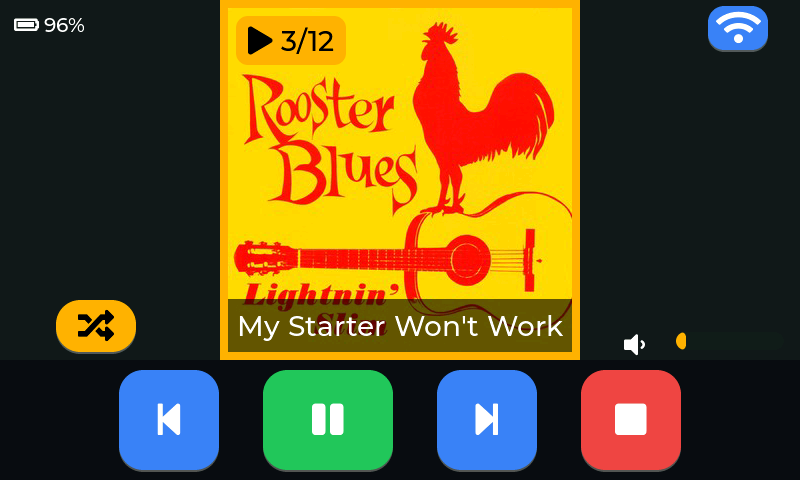

# esp32-simple-jukebox

MP3 player for the Sunton ESP32-8048S050C (ESP32-S3, 5" 800x480 RGB panel, GT911 touch, SD slot, I2S audio).

Made to be dead simple for older people: one big album cover on the screen, two big arrows to change album,
and only a few large buttons. Music is added from a phone or laptop through a built-in web page.

## Using the player



*The screen while a track plays in shuffle mode (taken with `GET /screenshot.png`, see below). Battery 96 %, the song title on the
cover, the badge shows track 3 of 12; the volume pot is connected, so there are no - / + buttons.*

The layout:

```
+--------------------------------------------------------------+
| [battery 78%]                                      [ WiFi ]  |
|   [ <- ]        +--------------------+          [ -> ]       |
|                 |                    |                       |
|                 |   album cover      |                       |
|                 |   360 x 360        |                       |
|   [shuffle]     |  [ song / album ]  |        (speaker) ===  |
|                 +--------------------+                       |
|  [|<]  [ Play/Pause ]  [>|]  [Stop]   [ - ]  [ + ]           |
+--------------------------------------------------------------+
```

The battery symbol only appears with the optional ADS1115 and a battery, the volume buttons `- / +` are only there without a
volume pot, see "Optional hardware" below.

* **Shuffle is on at power-up and the music starts by itself:** all tracks of all albums in random order (every track once, then
  reshuffled). The screen follows the music, the album arrows are hidden. Switching shuffle on while nothing plays starts it.
* **Tap the cover** of the playing album to pause, tap again to resume. Tapping another album starts it from its first track.
  A frame and a badge ("track 3/12") mark the playing album; the title on the cover shows the **song name** while it plays.
* **Shuffle button** (bottom left): tap to switch to album mode and back. In album mode the **arrows left/right** change the album
  on screen. If music was playing it stops at once; if the arrows are not touched for 3 seconds, the album now on screen starts by itself.
* **Play / Prev / Next** start the album on screen (or shuffle) when nothing is playing; otherwise they pause/resume and skip tracks.
  At the end of an album the next one starts, after the last one the first (endless play).
* **Stop** stops playback. **- / +** change the volume (0..20, the bar next to the cover shows it, startup volume 5). Even the
  lowest step is quietly audible, and stereo is mixed down to mono (one speaker); both are constants in `main/player.c`.
* **WiFi button** (top right) is for adding music, see below.
* **Display dimming:** after 90 s without touching the screen the backlight dims (timeout and brightness: web page, "Display").

## Adding music

WiFi is off during normal use. Tap the WiFi button: playback stops, the player opens an access point and shows a box with
the network name, the password and a QR code for joining.

| | |
| --- | --- |
| Network | `MyMusicPlayer` |
| Password | `music1234` |
| Web page | `http://192.168.4.1` |

These are the defaults (`main/wifi_ap.h`); the web page has a **Wi-Fi** section where you can change the name and the password (stored
in flash, used the next time the WiFi is switched on). If you forget them, erase the settings partition over USB to get the defaults back
(this also resets the dimming and battery calibration): `esptool.py --chip esp32s3 -p COMx erase_region 0x9000 0x6000`.

Open the page, then tap **Done** in the box on the player, or **Done** on the web page,
to switch WiFi off again. The library is rescanned and the covers reload.

The page is embedded in the firmware (`main/web/index.html`, no internet needed) and does all conversion in the browser:

* **Cover:** any picture, cropped to a square and scaled to 360x360 baseline JPEG.
* **Songs:** MPEG Layer III files are sent unchanged (ID3 tags stripped). Anything else (FLAC, WAV, M4A, OGG, ...) is
  decoded by the browser and encoded to 160 kbps MP3 with the bundled lamejs (`main/web/lame.min.js`, LGPL-3.0).
* Songs are stored as `NN_name.mp3` so the play order matches the order in the page. Use an existing album name to append songs.
* Per album: **Rename**, **Change cover**, **Add songs**, **Delete album**; single songs can be deleted too.
* **Sound:** bass and treble boost, 0 to +6 dB each (defaults +3 / +2), heard at once. A fixed high-pass at 80 Hz protects the small speaker
  (tuned for a Faital 3FE22 in a sealed enclosure of about 1.5 l: its cone only moves below that, and Xmax is 1.8 mm); no fixed level reduction: a soft limiter catches
  the peaks (only the top volume steps reach it). Bass is a low shelf at 160 Hz, treble a high shelf at 6 kHz (`main/eq.c`, about 1 % CPU). API: `GET /api/eq`,
  `POST /api/eq?bass=..&treble=..`.
* **Wi-Fi:** name and password of the access point (see "Using the player"); **System** tab: firmware update and screenshot.
* **Screenshot:** `GET /screenshot.png` (button on the System tab, or `python tools/musicplayer.py screenshot out.png`) returns the
  screen as a PNG, without the Wi-Fi box that covers it. LVGL renders the screen into a 768 KB buffer in PSRAM, the rows are compressed with
  the deflate code in the ESP32-S3 ROM (miniz) and streamed; the file is typically a few tens of KB. The screen freezes for a moment.
* **Display:** timeout until the backlight dims (seconds, 0 = never, default 90) and the dimmed brightness (130..255, default 190);
  stored in flash (NVS) and kept over restarts. API: `GET /api/settings`, `POST /api/settings?dim_s=..&dim_level=..`.
* **Battery:** with the optional ADC the page shows percent, smoothed and instantaneous voltage and the voltage at the ADC input
  (refreshed every 3 s, `GET /api/battery`), which helps to check the divider and the discharge curve.
* **Firmware update:** the page installs the `-ota.bin` image. An image that is not an app image of this project
  (for example the full image) is rejected.

### Scripting / AI agents

`tools/musicplayer.py` (Python 3, standard library only) drives the same REST API from a computer on the player's WiFi.
Switch upload mode on first (tap the WiFi button). Every command prints one JSON line and exits non-zero on failure. Upload and OTA show progress on stderr
("[ 42%] 03_song.mp3 (2/5) 80%", overall percent plus the current file; one updating line in a terminal, one line per file
otherwise); `--quiet` turns it off.

    python tools/musicplayer.py upload --album "Beatles - Abbey Road" --cover cover.png 01.mp3 02.flac --done
    python tools/musicplayer.py upload --album "Beatles - Abbey Road" --dir ./abbey_road   # audio files + cover.* from a folder
    python tools/musicplayer.py list | rename | delete | ota | done

* Album title = folder name (forbidden characters are removed, max. 60). The cover is centre-cropped to a 360x360 baseline
  JPEG (needs Pillow; without it only a JPEG is sent as it is). MP3 files are sent unchanged, other audio is converted with
  `ffmpeg` if installed. Tracks are stored as `NN_name.mp3`; an existing album gets the new tracks appended (`--replace` starts fresh).
* Plain HTTP for your own client (host `192.168.4.1`): `PUT /api/file?album=<title>&file=cover.jpg` with the JPEG as the body,
  `PUT /api/file?album=<title>&file=01_song.mp3` with the MP3 as the body (the album folder is created on the first PUT),
  `GET /api/albums` lists everything, `POST /api/done` leaves upload mode. No login: the WPA2 password protects the access point.

REST API: see `main/web_server.h`. Uploads go to a `.part` file first, so an aborted upload leaves nothing broken behind.

## Hardware

### Minimal build (USB powered)

* **Sunton ESP32-8048S050C** (ESP32-S3, 16 MB flash, 8 MB octal PSRAM, 5" 800x480 RGB panel, GT911 touch, SD slot).
* **Speaker** on the board's speaker connector. One channel is enough: stereo is mixed down to mono.
* **microSD card**, FAT32, in the board's slot (any size, see "SD card layout").
* **5 V supply** on USB-C (or the 5 V header). Nothing else is needed.

### Portable build (battery)

```
 18650 cells        BMS / charger            5 V step-up            Sunton board
 (1S3P)  --B+/B--> [ 03962A module ] --OUT--> [ MT3608 ] --5 V-->  USB-C / 5 V pin
                      |  USB-C charging         (set to 5.0 V
                      '- under-voltage cut-off   BEFORE connecting)
```

* **Cells:** one cell in series, parallel cells for capacity (the author uses 3 x 18650 = 1S3P). Matching, equally charged cells.
* **BMS: mandatory.** It must charge the cell safely (CC/CV to 4.2 V), cut off on **under-voltage** and on over-current/short circuit.
  The firmware only warns and stops the music when the battery is empty, it cannot switch the board off (the board draws about
  0.3 W even then). The author uses a **03962A** module, which handles all of that cleanly; any comparable charger +
  protection module works (for example TP4056 with DW01 + 8205 protection, make sure it has the protection part).
* **Step-up converter:** the cell delivers 3.0-4.2 V, the board wants 5 V. Use a boost converter such as the **MT3608**
  (adjustable; turn the trimmer to **5.0 V with a multimeter before connecting the board**, its default output can be far higher),
  or a boost stage that is already part of the charger module. Efficiency is typically 85-90 %, so the battery supplies a bit more than
  the board's power below. A larger output capacitor (e.g. 100-470 µF) close to the board helps with the current spikes of Wi-Fi.
* **Switch:** a slide switch in the battery lead between BMS and converter is a cheap way to switch the player off completely.

### Options

| Option | What you get | Needs |
| --- | --- | --- |
| Volume pot | analog volume knob, `- / +` buttons hidden | ADS1115 + 10 kΩ linear pot |
| Battery gauge | symbol and percent top left, low-battery warning | ADS1115 + 1:1 divider (2 x 100 kΩ) on the cell |
| Both | knob and gauge | one ADS1115 (AIN0 pot, AIN1 battery) |
| neither | touch volume buttons, no battery icon | nothing |

### ADS1115 wiring (volume pot and battery)

An ADS1115 on the touch I2C bus (SDA GPIO 19, SCL GPIO 20, address `0x48`, ADDR to GND) adds a volume knob and a battery gauge.
It is detected at power-up; without it everything works with the touch buttons and no battery icon.

| ADS1115 | Connect |
| --- | --- |
| VDD / GND | 3.3 V / GND (common ground with the board and the battery) |
| AIN0 | wiper of a 10 kΩ linear potentiometer, ends on 3.3 V and GND |
| AIN1 | battery through a 1:1 divider (e.g. 2 x 100 kΩ), so VBat = 2 x measured; 100 nF to GND at AIN1 helps |

* **Volume pot:** read 10 times a second, smoothed with hysteresis, 0..20 steps. With a pot the `- / +` buttons are hidden and the
  other buttons move together in the middle. Turning the pot keeps a bright screen on but does not wake a dimmed one.
* **Battery** (designed for one Li-ion cell, 1S, e.g. 1S3P 18650): symbol and percentage top left (white / amber below 30 % / red below 15 %).
  The percentage comes from a typical 18650 discharge curve on the smoothed voltage (`k_curve` in `main/volume_pot.c`; under load
  the voltage sags, so the value reads a little low while music plays). Below 10 % a red "Battery low" banner appears. At 3 % for 20 s
  the player stops, shows "Battery empty - please charge" and switches the backlight off 10 s after the last touch (a touch shows
  the message again). It does **not** power anything down: the board still draws about 0.3 W, so a **BMS with under-voltage
  cut-off is mandatory**, see "Hardware".
  Below 2.5 V at the pin (no battery) the icon, warning and shutdown are disabled; above 4.6 V (external supply) a charge symbol is shown.
  **Charging** is guessed from the voltage trend (a charger lifts the voltage by tens of mV: a rise of more than 20 mV plus 3 mV per minute
  within the last 10 minutes counts; the same the other way round when it is unplugged). While charging, a bolt replaces the
  percentage (it would read too high), the low-battery warning is off and an "empty" player wakes up. A battery that is already full
  shows no trend and is not detected as charging.
  **Calibration:** divider tolerance and the ADS1115 input load can make the voltage read about 1 % off. Measure the battery with a
  multimeter and enter the value on the web page (below the firmware version); the correction (max. +-10 %) is stored in flash.

## Power consumption

Measured while playing music: about **1.5 W at full brightness** and about **0.65 W with the dimmed backlight**
(the backlight is the biggest consumer, which is why the screen dims after 90 s). As a rough example, 3 x 2500 mAh 18650 cells
(about 28 Wh) would last on the order of 15 hours at full brightness and 35 hours or more dimmed, less in practice because of
converter losses and the voltage cut-off.

**After "battery empty" the board still draws about 0.3 W** (measured, music stopped and backlight off): regulators, USB serial chip,
amplifier and panel electronics stay powered and the firmware cannot switch them off. That is roughly 80 mA from a 3.7 V cell, so the
firmware is no protection for the battery: a **BMS with under-voltage cut-off is mandatory**.

## SD card layout

FAT32, one folder per album:

    /<Album name>/cover.jpg     square cover, optional (360x360 is shown 1:1, other sizes are stretched)
    /<Album name>/<track>.mp3   tracks, played in file name order (01_, 02_, ...)

The folder name is the title shown on the cover. Files at the card root are ignored. The web page creates this layout.

## Build and flash

ESP-IDF 5.5.x, target ESP32-S3:

    idf.py set-target esp32s3
    idf.py build flash monitor

`.\build_release.ps1` (PowerShell with the IDF environment) builds and writes two files to `release/`:

| File | Content | Use |
| --- | --- | --- |
| `esp32-cyd-musicplayer-full.bin` | bootloader + partition table + otadata + app | first flash over USB at **0x0**: `esptool.py --chip esp32s3 -p COMx write_flash 0x0 release\esp32-cyd-musicplayer-full.bin` |
| `esp32-cyd-musicplayer-ota.bin` | app only | update through the web page (written to the inactive slot) |

Every run of these scripts writes the current date and time to `build_stamp.txt`. It becomes the app version, shown on the
web page as "Firmware build 2026-10-20 14:44:17" and in the boot log (`App version`). A plain `idf.py build` keeps the last stamp.

`.\build_variant.ps1 <name>` builds an experiment with `sdkconfig.defaults` + `sdkconfig.<name>` into `build_variant_<name>\`
and `release\esp32-cyd-musicplayer-<name>-{ota,full}.bin`. Delete `sdkconfig` after editing `sdkconfig.defaults`.

Partition table (`partitions.csv`, 16 MB flash): nvs 0x9000, otadata 0xf000, phy_init 0x11000, ota_0 0x20000 (6 MB),
ota_1 0x620000 (6 MB); about 3.9 MB stay free. Changing this layout later needs a full USB flash.

## Pins

| Function | GPIO |
| --- | --- |
| SD CS / MOSI / SCLK / MISO | 10 / 11 / 12 / 13 |
| I2S BCLK / LRC / DOUT | 0 / 18 / 17 |
| Touch SDA / SCL / RST (same I2C bus for the ADS1115) | 19 / 20 / 38 |
| Backlight | 2 |

The SD and I2S pins are the GPIOs left free by the RGB panel, taken from the Elecrow 5" ESP32-S3 wiki. The touch range is read
from the GT911 at startup.

**Start-up noise:** the MAX98357A amplifier turns floating inputs into noise while the chip boots. Three things keep it quiet (together
they solved it on the author's board): the I2S clocks start as the first thing in `app_main()`; a small bootloader hook
(`bootloader_components/my_boot_hooks`) drives GPIO17 (DIN) and GPIO18 (LRC) low from the first moment of the bootloader (needs the full
image over USB, an OTA update does not replace the bootloader); and optionally a 10 kΩ pull-down from GPIO17 and from GPIO18 to GND.
**Never put a pull-down on GPIO0 (BCLK):** it is a strapping pin and the chip would boot into download mode. The PSRAM test and the image hash
check at power-up are switched off in `sdkconfig.defaults` to shorten the boot.

## Display notes (hard-won)

The RGB framebuffer lives in PSRAM, which shares its bus with the panel DMA, WiFi and the code (it runs from PSRAM).
Bandwidth conflicts show up as brief sideways shifts of the picture. What works on this board:

* **Bounce buffer (default):** the panel DMA reads small internal-RAM buffers (10 lines) that an interrupt refills from the
  PSRAM framebuffers. This removed the sideways shifts. It needs `CONFIG_LCD_RGB_ISR_IRAM_SAFE=y`, so the flush callback is
  `IRAM_ATTR`, and 64-byte data cache lines. Two framebuffers, LVGL in direct mode.
* **LVGL task pinned to core 1:** core 0 runs the refill interrupt and WiFi.
* **`-O2`:** the IDF default `-Og` (debug) made drawing visibly slow.
* **Pixel clock must stay at 16 MHz.** 12 MHz makes the panel lose sync (it shows the RGBW test pattern); changing the clock at runtime too.
* `CONFIG_LCD_RGB_RESTART_IN_VSYNC=y` resyncs the DMA every vblank, so WiFi traffic can never leave a permanent shift.
* The MP3 decoder (libhelix) is linked into internal RAM (`main/linker.lf`) so decoding does not compete for PSRAM bandwidth.
* `CONFIG_ESP_MAIN_TASK_STACK_SIZE=16384`: building the UI with 360 px covers overflows the default stack.

Tried and dropped: no bounce buffer (fast but the shifts return), a single framebuffer with partial rendering (far too slow),
flash and PSRAM at 120 MHz (does not boot on this unit, its flash is reported as "generic"), runtime pixel clock changes.

## Code map

* `main.c` startup; `sunton_esp32_8048s050c.c` board: panel, backlight, touch, LVGL port
* `sd_card.c` mounts the card at `/sdcard` (SPI); `library.c` scans albums and tracks
* `player.c` decode task (priority 5, core 1): play/pause, stop, next, prev, volume; calls are non-blocking
* `ui.c` one-album screen, arrows, control bar; the player task never takes the LVGL lock, the UI polls a state snapshot every 100 ms
* `wifi_ap.c`, `web_server.c`, `upload_mode.c`, `web/` upload mode (access point, REST API, web page)
* `eq.c` tone control (high-pass, bass and treble shelves)
* `volume_pot.c` ADS1115 reader task (pot on AIN0, battery on AIN1, discharge curve, charge detection); `settings.c` dimming and battery calibration in NVS

## Status

Tested on hardware: display, touch, SD library, playback, shuffle, web upload, album edit, OTA update, glitch-free display with the
bounce buffer, ADS1115 volume pot, battery gauge and display dimming.
Not yet verified: the Wi-Fi stability changes (20 MHz channel), SD pins on other board revisions. App rollback is not enabled.

## License

MIT, see `LICENSE`, with these exceptions:

* `main/sunton_esp32_8048s050c.c` and `.h` (board support: panel, touch, LVGL port) are based on
  [mr-sven/esp32-8048S050C](https://github.com/mr-sven/esp32-8048S050C) by Sven Fabricius (see the file headers) and are not
  covered by this license. That repository has no license file at the moment; if you know its terms, please open an issue.
* `main/web/lame.min.js` is lamejs, LGPL-3.0.
* Dependencies (ESP-IDF, LVGL, esp_lcd_touch_gt911, libhelix MP3) are downloaded by the build and keep their own licenses.
